<!-- Header banner -->

  

  

  

  
  
  
  
  

---

## 📜 Character sheet

<table>
  <tr><td><b>Name</b></td><td>Joseph “Joe” Kamau &nbsp;ジョー</td></tr>
  <tr><td><b>Class</b></td><td>Founder · Full-stack engineer · QA automation</td></tr>
  <tr><td><b>Home base</b></td><td>Nairobi, Kenya 🇰🇪</td></tr>
  <tr><td><b>Main quest</b></td><td>Make it easy to bring people together, via <a href="https://alika.app">Alika</a></td></tr>
  <tr><td><b>Side quest</b></td><td>Keeping the Harvard Business Review app bug-free</td></tr>
  <tr><td><b>Special move</b></td><td>Turning chaotic group chats into actual plans</td></tr>
  <tr><td><b>Training arc</b></td><td>Karate 🥋 (空手)</td></tr>
  <tr><td><b>Known weakness</b></td><td>“Just one more feature…”</td></tr>
</table>

## ⚡ Current arc

<table>
  <tr>
    <td width="50%" valign="top">
      <h3>🚀 Building <a href="https://alika.app">Alika</a></h3>
      
<b>Skip the group chat.</b> Alika helps friends and communities plan hangouts: invites &amp; RSVPs, shared playlists, contributions, ticketing and built-in party games.

      
<i>Founder, CEO &amp; CTO</i>

    </td>
    <td width="50%" valign="top">
      <h3>🧪 Engineering at HBP</h3>
      
QA &amp; automation engineer on the <b>Harvard Business Review app</b> at Harvard Business Publishing, building the test automation that keeps every release solid.

      
<i>Software Engineer</i>

    </td>
  </tr>
</table>

## 📈 Power levels (Alika)

<table>
  <tr>
    <td align="center" width="33%"><h2>~2,000</h2>users</td>
    <td align="center" width="33%"><h2>1,000+</h2>new users in 3 months</td>
    <td align="center" width="33%"><h2>400+</h2>hangouts planned</td>
  </tr>
</table>

## 🗡️ Weapons of choice

  

## 📊 Battle stats

  
  

## 🥋 Training arc

I practise karate (空手, “empty hand”). Discipline on the mat, consistency in the code.

## 🤝 Join the party

Happy to talk startups, community products, test automation, or building from Nairobi for the world. Find me on [LinkedIn](https://linkedin.com/in/joseph-kamau-244295200/) or [email me](mailto:gicugumajoseph@gmail.com).

<!-- Footer banner -->

  

